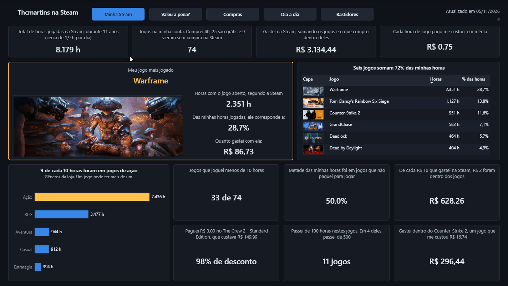
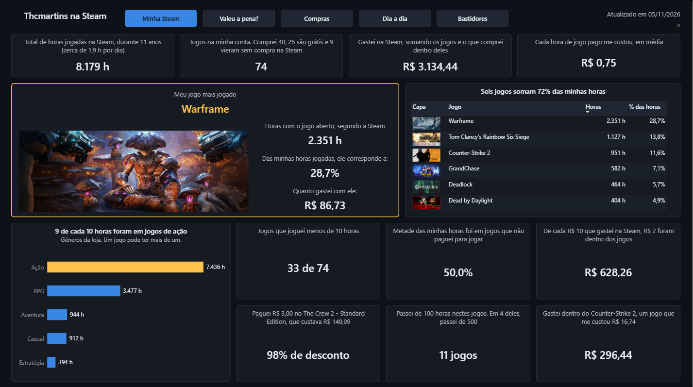
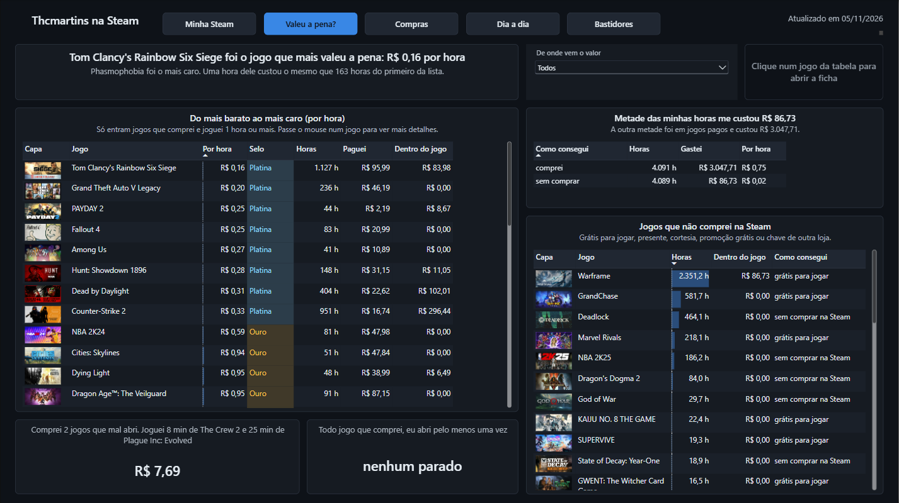
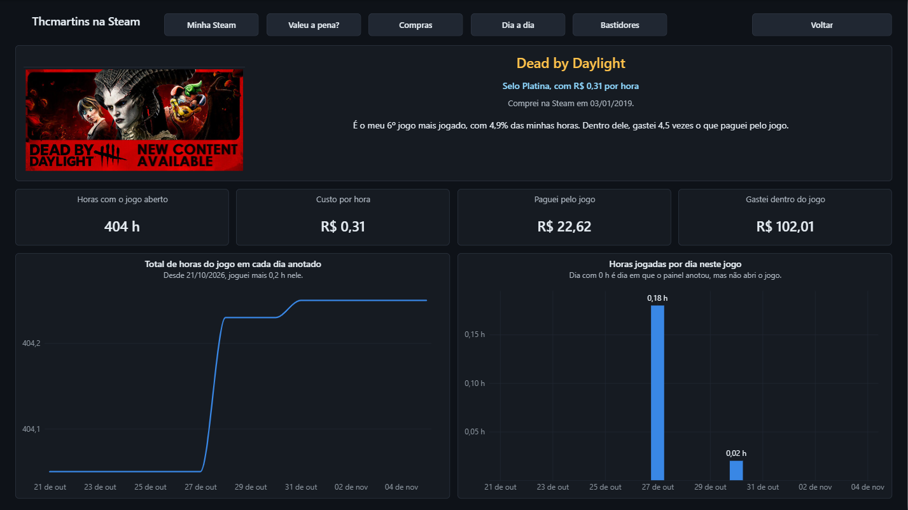

# steam-cost-per-hour

> **EN:** A case study of my own Steam account. A Python pipeline on GitHub Actions stores a daily snapshot of my playtime from the Steam Web API in PostgreSQL (Supabase), SQL views combine it with my purchase history, and a Power BI dashboard shows the cost per hour of each game. Work in progress.

> Este README ainda é provisório, porque o projeto está em construção. A versão final, com o diagrama do fluxo e prints do painel, fica pronta no fim da v1.



## O que é

Um estudo de caso da minha própria conta na Steam. Um pipeline de dados junta as horas jogadas de cada jogo com o valor que paguei por ele, e o painel responde perguntas como:

- Qual jogo saiu mais barato por hora de diversão?
- Quanto dinheiro está parado em jogos que nunca abri?

A especificação completa está em [docs/spec.md](docs/spec.md) e o plano de trabalho em [docs/tickets.md](docs/tickets.md).

## Stack

Python (Requests, BeautifulSoup, psycopg), PostgreSQL (Supabase na nuvem), GitHub Actions, Docker, pytest e Power BI (DAX e Power Query, projeto PBIP).

## Como funciona

A API da Steam informa só o total acumulado de minutos de cada jogo, sem histórico. Por isso a coleta diária grava um snapshot desse total em `playtime_snapshots`, e a chave primária garante uma linha por usuário, jogo e dia. As horas de cada dia saem da diferença entre um snapshot e o anterior, calculada no SQL com a função de janela `LAG`. Quando falta um dia de coleta, o intervalo inteiro vai para o último dia, e a coluna `days_covered` mostra quantos dias ele cobre. Se um total diminui, ele aparece na view `collection_quarantine` com o motivo, em vez de virar hora negativa.

Rodar a coleta duas vezes no mesmo dia não duplica nada, porque ela grava com `INSERT ... ON CONFLICT DO UPDATE` e só atualiza o snapshot daquele dia. O catálogo da loja é incremental e só consulta os jogos que ainda não têm preço gravado, com 1,5 s de pausa entre pedidos. Um preço já gravado nunca é sobrescrito.

O histórico de compras não tem API. Salvo a página da Steam pelo navegador, e um script lê o HTML com BeautifulSoup no meu computador. Cada linha vira compra ou vai para a tabela `quarantine` com o motivo (crédito de carteira ou compra em outra moeda, por exemplo). Um hash SHA-256 de cada linha permite carregar o mesmo arquivo de novo sem duplicar nada. Pacotes são divididos entre os jogos pelo preço de tabela de cada um, em centavos inteiros e pelo método dos maiores restos, para que a soma das partes bata com o valor pago.

As regras de negócio ficam em views no PostgreSQL (`sql/views.sql`), e o Python só coleta e carrega os dados. Com isso, corrigir uma regra não exige coletar nada de novo. Os testes rodam com pytest no PostgreSQL local do Docker, com dados fictícios e rollback no fim de cada teste. Para conferir o painel, `docs/fact_checks.sql` tem 31 consultas SQL independentes, uma por fato, que recalculam cada número direto das views, sem passar pelas medidas DAX.

## Ambiente local

Pré-requisito: [Docker Desktop](https://www.docker.com/products/docker-desktop/) aberto.

```bash
# 1. Crie o arquivo de variáveis a partir do modelo e preencha os valores
cp .env.example .env

# 2. Suba o banco PostgreSQL e o ambiente Python
docker compose up -d

# 3. Rode os testes dentro do ambiente
docker compose exec app pytest

# Para desligar
docker compose down
```

O banco local fica acessível pelo Windows (pgAdmin, DBeaver, Power BI) em `localhost:5433`, com o usuário e a senha definidos no `.env`.

## Pipeline

```bash
docker compose exec app python -m src.create_tables  # cria tabelas e views e aplica as migrações (pode rodar de novo)
docker compose exec app python -m src.run_daily      # coleta todos os usuários e atualiza o catálogo
docker compose exec app python -m src.catalog        # só o catálogo, com a lista de jogos sem preço
docker compose exec app python -m src.purchase_history data/private/purchase_history.html --user <apelido>
docker compose exec app python -m src.fact_checks    # recalcula cada fato do painel em SQL, numa sessão só de leitura
```

O arquivo é a página *Purchase History* da conta, salva com a Steam em inglês, porque o script lê esse formato (tipos como "Purchase" e "Refund" e datas como "27 Oct, 2026"). Antes de salvar, clico em *Load more* até o botão sumir, já que a carga recusa uma página incompleta, e guardo o arquivo em `data/private/`, pasta que o Git ignora.

As contas coletadas ficam na variável `STEAM_USERS` (`steamid:apelido`, separadas por `;`), e a lista só tem pessoas que concordaram. Cada execução fica registrada na tabela `pipeline_runs`, com início, fim, status (`success`, `partial` ou `failed`), contagens e erros. A linha é gravada como `running` logo no começo, então uma execução que morre no meio continua visível.

## Banco na nuvem (Supabase)

Para usar o Supabase, o código é o mesmo e só mudam as variáveis de ambiente. Uso o *Session pooler* porque a conexão direta do Supabase é só IPv6, e os runners do GitHub não têm IPv6. Crie o `.env.cloud` com os dados do *Session pooler* do projeto e `POSTGRES_SSLMODE=require` (veja o `.env.example`), e use o serviço `app-cloud`:

```bash
docker compose run --rm app-cloud python -m src.create_tables
docker compose run --rm app-cloud python -m src.run_daily
```

## Coleta automática (GitHub Actions)

O workflow `.github/workflows/daily-collection.yml` roda o pipeline uma vez por dia num runner do GitHub, e os dados vão para o Supabase. Ele está agendado para as 03:17 (horário de Brasília) e também pode ser disparado pelo botão *Run workflow*. Na prática, o GitHub costuma iniciar execuções agendadas com atraso. Em outubro de 2026, elas começaram entre 8h05 e 10h07, umas 5 a 7 horas depois do horário marcado. O agendamento de madrugada deixa folga para esse atraso, e a data do snapshot é calculada no fuso de São Paulo (o runner usa UTC), então o dia registrado não muda. As credenciais ficam nos segredos do repositório.

Cada usuário é coletado na própria transação, então a falha de um (um perfil privado, por exemplo) desfaz só os dados dele. Se qualquer parte falhar, o script termina com código de saída 1, a execução fica vermelha na aba Actions e o GitHub envia um e-mail.

O GitHub desativa agendamentos em repositórios públicos sem atividade há 60 dias. Se isso acontecer, basta reativar o workflow na aba Actions.

O Supabase publica as tabelas do schema `public` numa API REST automática (PostgREST). Para fechar essa porta, todas as tabelas têm Row Level Security ligado e nenhuma política, e assim os papéis da API (`anon` e `authenticated`) não enxergam nenhuma linha. O pipeline e o Power BI conectam com o usuário dono das tabelas, que o RLS não restringe. As views usam `security_invoker`, porque sem essa opção uma view roda com as permissões do dono e passaria por cima do RLS. Quando conferi no Security Advisor do Supabase, o único aviso foi o informativo de RLS sem políticas.

## Painel







O painel do Power BI está em `dashboard/`, salvo como projeto (`.pbip`), com o modelo semântico em TMDL e o relatório em PBIR. São arquivos de texto, então cada medida DAX ou visual alterado aparece no diff do Git. O painel importa as views do banco (modo Import), e o servidor e o nome do banco são parâmetros do Power Query, o que permite apontar o mesmo arquivo para o banco local ou para o Supabase. O cache com os dados importados fica fora do Git.

O Supabase assina os certificados do banco com uma autoridade certificadora (CA) própria, que o Windows não conhece, e o conector PostgreSQL do Power BI só confia nas CAs instaladas no Windows. Em vez de instalar essa autoridade no sistema, o painel passa pelo container `supabase-tunnel` (pasta `tunnel/`). O Power BI conecta em `localhost:5434`, um trecho que não sai do computador, e o túnel (stunnel) abre a conexão TLS com o pooler do Supabase e confere a cadeia do certificado até a CA raiz do Supabase e o nome do servidor. Para atualizar o painel, o ambiente precisa estar ligado (`docker compose up -d`). No Power BI, essa fonte de dados fica com "Criptografar conexões" desmarcado, já que a criptografia é feita pelo túnel.

## Privacidade

Credenciais ficam só no `.env` (ignorado pelo Git) e nos segredos do GitHub. O arquivo do histórico de compras é lido no meu computador e nunca vai para o repositório, e a carga não grava forma de pagamento, saldo da carteira, destinatário de presente nem número da transação. O SteamID só entra no banco como HMAC-SHA256, um hash com chave secreta. Um SHA-256 simples não bastaria, porque os SteamIDs ficam numa faixa conhecida e daria para calcular o hash de cada um até achar o meu. As mensagens de erro, que aparecem nos logs públicos do Actions, citam o apelido ou a posição na lista, nunca o SteamID ou a chave da API.

## Próximos passos

Os dados são só da minha conta, mas o banco já foi desenhado para vários usuários: as tabelas com dados pessoais levam um código pseudonimizado de usuário (o HMAC do SteamID) e a coleta só inclui quem concordou. O Row Level Security já está ligado, mas ainda sem políticas. Numa fase com outros usuários, cada tabela precisaria de uma política que limite as linhas ao código de quem consulta. A ideia para uma segunda fase é um site em que outra pessoa informa o próprio perfil público e vê a biblioteca dela, com as horas e um custo por hora estimado pelo preço da loja. O envio do histórico de compras seria opcional, para quem quiser o valor exato. Essa fase ainda vai ganhar uma especificação própria.

## O que aprendi

O projeto me fez pensar em quanto um dado pode se distanciar da realidade que ele parece descrever. A Steam diz que tenho mais de 2.000 horas de Warframe, mas isso não quer dizer que passei esse tempo todo jogando. O que ela mede é o tempo com o jogo aberto, e isso inclui partidas de verdade, o jogo esquecido em segundo plano e as horas em que fiquei logado e parado só para ganhar recompensas. Existem até jogos feitos para isso, os *idle games*, que progridem sozinhos enquanto ficam abertos.

Ou seja, o número está certo, mas responde a uma pergunta diferente da que parece. O custo por hora deste painel é o custo por hora com o jogo aberto, e por isso pode sair mais baixo do que o custo de cada hora em que eu estava de fato jogando. A lição que levo para outras análises é entender como o dado foi gerado e o que ele mede antes de tirar conclusões.
